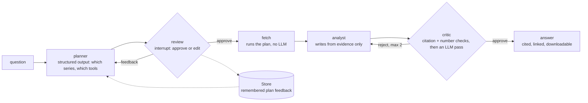

# macrodesk

**An agentic macro research desk over FRED.**

[](https://github.com/dakshinsiva/macrodesk/actions/workflows/ci.yml)


[](https://macrodesk-agent.vercel.app)

Ask a macro question in plain English and get back an analyst's answer in which every number carries
its FRED series id and observation date, with the data fetched live from the St. Louis Fed, a chart
when one helps, and a fact-checker's verdict on the draft. Before anything is fetched, the agent shows
you its plan and waits: approve it, or tell it to use ten years of history instead of three, and it
re-plans. What you tell it at that step, it remembers next time.


*Thirty seconds of the research desk: the macro dashboard, a plan proposed and approved, evidence
fetched, a chart, the draft streamed, the critic's verdict and the cited answer.*


*A JOLTS question in the research desk. Top, the macro dashboard and the pipeline strip. Then the plan
the agent proposed and the user approved, the evidence it fetched (a four-series JOLTS table), the
chart drawn from the same data, and the answer with each figure linked to its FRED series. The critic
approved this draft on the first pass.*

## Why this is hard

Language models are fluent about the economy and will happily tell you that job openings "peaked near
12 million in 2022" without having looked. In the first version of this agent the model did exactly
that: the number was roughly right, it was uncited, and it came from training memory rather than from
the four series it had just fetched. A prompt that says "cite everything" lowers the rate of such
claims; it does not make them detectable.

So the answer has to be *verifiable by construction*. The plan is data, not prose, so a person can
approve it. Fetching is deterministic, with no model in the loop. The writer only sees the evidence.
And a separate critic compares the draft with the evidence and sends it back when a figure, date,
peak or range is not there. Along the way the usual things went wrong, each one is written up, and
they are the part of this repository most worth reading: [docs/02-debugging.md](docs/02-debugging.md).

## Pipeline



| Node | Model? | What it does |
|---|---|---|
| **planner** | yes, structured output | Turns the question (plus anything you said at earlier reviews, and earlier turns in the thread) into a list of tool calls over 18 tools and a curated registry of 24 FRED series. Every step's arguments are validated against the tool's schema before anything runs |
| **review** | no | Pauses the graph with `interrupt()` and shows the plan. Resume with "approve" or with feedback; feedback is also written to long-term memory |
| **fetch** | no | Executes the steps concurrently against FRED through a cached, retrying client. Errors are recorded as evidence, not raised. Evidence from earlier turns is carried forward for follow-ups |
| **analyst** | yes | Writes the answer from the evidence block only, citing `(SERIES_ID, YYYY-MM-DD)` and stating units |
| **critic** | yes + deterministic | Two deterministic checks (every cited series and date exists in the evidence; every number is in the evidence, scaled, or derivable as a difference or percent change), then an LLM pass for the rest. Rejections go back to the analyst, at most twice |
| **finalize** | no | Posts the answer; if issues remain after the cap, they are appended rather than hidden |

Stage 1 of the project, a prebuilt ReAct agent with the same tools, is kept as `--v1` for comparison.

**The 18 tools.** Retrieval: `list_known_series`, `search_fred`, `get_series`, `compare_series`,
`compute_change`, `yield_curve_snapshot`, `recession_periods`, `plot_series`. Vintages and releases
(ALFRED): `series_as_of` (what was known on a date), `revision_history` (first print to latest),
`release_calendar` (past and next release dates). Context and analytics: `extremes` (max and min
*with dates*), `percentile_rank`, `compare_to_prepandemic`, `sahm_rule`, `recession_probability`
(NY Fed-style probit on the 10y-3m spread), `correlate`, `macro_snapshot`.

## The research desk

The web app in `web/` is a Next.js front end to the LangGraph server, deployed at [macrodesk-agent.vercel.app](https://macrodesk-agent.vercel.app), where it replays a recorded run on arrival. It is built for someone who
works with this data rather than for a chat demo:

| | |
|---|---|
|  |  |

*Left, the plan review: the agent has proposed two tool calls and is waiting. Right, the desk on
arrival in light mode: six indicators with sparklines and 12-month changes; clicking one asks about it.*

- **A command line, not a chat box.** One input at the top takes a question, a series mnemonic
  (`UNRATE` opens its card), or a slash command (`/new`, `/threads`, `/prefs`, `/brief`). `⌘K` or
  `/` focuses it from anywhere; `↑` recalls history; suggestions come from the series registry.
- **Keyboard first.** `Enter` approves a pending plan, `E` opens the step editor, `Esc` cancels a
  run or closes a card. A status bar shows live/demo, thread, user, the last run's time, and the keys.
- **Series cards.** Any series id, in the command line, a dashboard tile or an answer's sources,
  opens a card: latest value and change, sparkline, metadata, and one-click "ask", "plot" and
  "revisions and next release" questions.
- **Macro dashboard as a watchlist.** Unemployment, quits, openings, the 10y–2y spread, core PCE
  and real GDP by default, with sparklines and the change over the natural horizon; customise the
  tiles from the registry and they persist.
- **Monitor pane.** On wide screens, charts, sources and follow-ups stay in a right-hand pane while
  the answer scrolls on the left.
- **Evidence as tables.** Date-indexed tool results render as aligned numeric tables with a raw
  toggle; every block copies with one click.
- **Plan review in the page.** Approve, type feedback and watch the plan change, or edit the steps
  inline (tool, arguments, add or remove) and run the edited plan. The same `Command(resume=...)`
  path serves the CLI, the REST API and LangGraph Studio.
- **Evidence you can read.** Every tool result is shown as fetched, with a green or red mark.
- **Charts from the same data.** One panel per series (never a dual axis), NBER recessions shaded,
  the latest value labelled.
- **Citations that go somewhere.** `(UNRATE, 2026-09-01)` is a link to the series on FRED; the
  sources used are listed under the answer; copy as markdown or download. Charts export as CSV
  and PNG; evidence blocks copy with one click.
- **Follow-ups.** Suggested next questions built from the series the answer cited.
- **Trace.** Per-node timings, the raw graph state, and a link to the run in LangSmith when
  tracing is configured.
- **Demo mode.** With no backend configured the page replays a recorded run, so the deployed URL
  always shows the whole pipeline.

## Output

From a run on 2026-10-13, *"What does the latest JOLTS report say about the labor market?"*:

> Job openings fell to 7,079,000 in August 2026 (JTSJOL, 2026-08-01), down from the series peak of
> 12,301,000 in the window — a decline of roughly 42%. Quits held at 1.9% (JTSQUR, 2026-08-01),
> matching the window low. Layoffs totalled 1,641,000 (JTSLDL, 2026-08-01), close to the series mean,
> so the market is cooling without a layoff spike. *Caveat: the 12,301,000 peak is the maximum of the
> retrieved window (from 2021-01-01); the all-time peak date was not retrieved.*

The caveat is the point: the analyst had the window summary but not the peak's date, said so, and the
critic let it through. (It is also why `extremes` now exists: a peak comes with its date.)

## Measured

The eval harness runs 24 questions, including adversarial ones, through the real graph and model
and scores each on four things. Latest run, 2026-10-13, recorded in LangSmith as experiment
`macrodesk-v2-ec14ed3e`:

| score | mean | what it checks |
|---|---|---|
| `tools_ok` | 1.00 | expected tools present, forbidden tools absent |
| `citations_grounded` | 1.00 | every `(SERIES, date)` exists in the fetched evidence (deterministic) |
| `critic_approved` | 1.00 | the final draft passed the critic within two revisions |
| `series_coverage` | 0.98 | expected series present in the plan (one case fetched one of two) |

The critic itself is measured separately on labelled drafts (`evals/run_critic_evals.py --llm`):
the deterministic layer, the model layer and the combined gate each score precision 1.00 and
recall 1.00 on that set. It did not start there: the model layer measured 0.71 precision until
verified numbers were allowed to overrule it (debugging note 20). The first eval run also found
two bugs the unit tests had passed over (notes 11 and 12). Typical answer latency is now 10 to
45 seconds with the fetch steps running concurrently.

## Setup

Python side (the agent, CLI, LangGraph server):

```bash
uv sync
cp .env.example .env            # FRED_API_KEY (free), ANTHROPIC_API_KEY, optional LANGSMITH_*
uv run macrodesk "Is the yield curve inverted right now?"   # pauses for plan approval
uv run macrodesk --auto-approve "..."                        # skip the review
uv run macrodesk --v1 "..."                                  # the Stage 1 ReAct agent
uv run macrodesk brief                                       # outputs/brief-<date>.md
uv run pytest                                           # 45 offline tests, no keys needed
uv run python evals/run_evals.py [--langsmith]          # 24 end-to-end cases, scored; optional LangSmith experiment
uv run python evals/run_critic_evals.py [--llm]         # the critic measured against labelled drafts
scripts/studio.sh                                       # LangGraph server + Studio (CLI layered on with `uv run --with`; not in the lock file)
```

The research desk, against that server:

```bash
cd web && npm install
cp .env.example .env.local      # LANGGRAPH_API_URL=http://127.0.0.1:2024, FRED_API_KEY for the dashboard
npm run dev                     # http://localhost:3000 ; add ?demo=1 to force the recorded replay
npm test && npm run test:e2e    # vitest unit tests; Playwright replay test and a button-and-link audit
```

Set `DATABASE_URL` to a Postgres URL and both the checkpointer and the Store move there, for
several machines or a hosted server sharing threads and memory; SQLite otherwise.

Inside the CLI: `/state`, `/history`, `/replay N` (time travel to a checkpoint), `/threads`,
`/thread <name|new|rename|delete>`, `/prefs`, `/forget`. `--thread NAME` resumes a conversation,
`--last` the most recent one, `--user NAME` keeps a separate memory per person.

## Deploying the desk

Step-by-step for a live backend behind the hosted site: [docs/06-live-backend.md](docs/06-live-backend.md).

The Next.js app deploys to Vercel as is. Point `LANGGRAPH_API_URL` and `LANGSMITH_API_KEY` at a
LangSmith Deployment of this graph for a live backend, or set `NEXT_PUBLIC_DEMO=1` for the replay.
`FRED_API_KEY` on the server enables the live dashboard; without it the recorded snapshot is shown.

## Decisions

- **Plan as data.** Structured output turns "which tools" into something a human can approve or edit
  before any time or money is spent, and something tests can assert on exactly.
- **Fetch has no model.** Deterministic execution of an approved plan is cheap, testable and cannot
  hallucinate. The FRED client caches to disk by (call, args, day), so a debugging session replays
  offline and test fixtures were recorded straight from the cache.
- **Tools return text the model can cite.** Series id, units and observation dates in every output;
  errors returned as `ERROR: ...` strings so the loop can self-correct rather than crash.
- **Two checks are better than one judge.** The regex citation check never misfires; the LLM critic
  catches what regex cannot (an uncited "peak", a unit error) and was itself measured for false
  rejections before being trusted as a gate.
- **State is a wire format.** Graph state holds plain dicts; Pydantic models are validated inside
  nodes. Every checkpointer (SQLite, the server's, Postgres) can serialise it.
- **Identity and session are configuration.** `thread_id` selects the checkpoint lineage and
  `user_id` the memory namespace, both in `config["configurable"]`; one compiled graph serves every
  user from the CLI, the API and Studio.
- **Memory is narrow on purpose.** Only plan-review feedback is persisted. It is high-signal because a
  person just said it was worth saying, and cheap to apply.

## What I learned, who it is for, what it cannot do

The short version; the full write-up is [docs/04-reflections.md](docs/04-reflections.md).

**Learned.** Grounding is verified, not prompted: the first version cited a
2022 peak from memory, and only a critic made that detectable. Make the plan
data and put the human before the cost. Be deterministic wherever a model is
not needed; the regex check never misfires, the model critic had to be measured
before it could be trusted. Tool output design beats prompt wording. Fourteen
of sixteen logged failures were environmental, not the model. Convenient test
doubles hide integration bugs; the eval harness caught what unit tests could not.

**For.** People who have to defend a number: research associates and
economists writing client notes, policy analysts, journalists and students who
know the concept but not the series id, and teams that need an audit trail of
plan, evidence and verdict. The pattern transfers to any source with stable
identifiers and release dates; FRED is the demonstration.

**Limits.** FRED only, no data vintages, description not forecasting, a critic
that checks numbers not economic logic, 40 to 90 seconds per answer, a human
review step that is both the safeguard and the bottleneck, thin memory by
design, single-machine persistence, six eval cases, one model tuned.

## Debugging log

Twenty-five incidents so far, each with the symptom, how it was localised and the fix:
a native wheel that tried to compile Rust, a gateway that silently rewrote the model endpoint, a
400 from a prompt with no user turn (twice: once in Studio, once in my own critic), a circular
import, Pydantic objects in checkpointed state, a critic that rejected correct arithmetic, two
libraries sharing one SQLite connection, and a `copy_thread` that exists on the base class but not in
SQLite, two from wiring the web app, and three from the planner's arguments, the analyst citing
an earlier answer, and a leaky number whitelist. [docs/02-debugging.md](docs/02-debugging.md).

## Layout

| Path | What it is |
|---|---|
| `src/macrodesk/graph.py`, `nodes.py`, `state.py` | The Stage 2 graph: planner, review, fetch, analyst, critic, finalize |
| `src/macrodesk/tools.py`, `fred/` | Eighteen tools over a cached, retrying FRED client (incl. ALFRED vintages) and a curated series registry |
| `src/macrodesk/charts.py` | Small-multiple PNG charts for the CLI; JSON payloads for the web |
| `src/macrodesk/memory.py`, `threads.py`, `persistence.py` | Store-backed plan memory; thread list, rename, delete; SQLite or Postgres behind one factory |
| `src/macrodesk/cli.py`, `brief.py` | REPL with checkpoint inspection and time travel; the daily brief |
| `web/` | The research desk: Next.js 16, LangGraph SDK `useStream`, Recharts |
| `tests/`, `web/e2e`, `web/src/lib/__tests__` | 45 offline Python tests; vitest and Playwright for the web |
| `evals/` | 24 end-to-end cases and a labelled critic set, scorers, LangSmith experiment, nightly workflow |
| `docs/` | Architecture, the debugging log, interview notes, reflections, the LangGraph/LangSmith guide |

## Built by

Dakshin Siva — [github.com/dakshinsiva](https://github.com/dakshinsiva) · dakshinrajsiva@gmail.com

Built with Claude Code as a from-the-ground-up exercise in constructing and debugging LangGraph
agents; every incident in the debugging log happened as described. Data from FRED, Federal Reserve
Bank of St. Louis. Licensed MIT.
